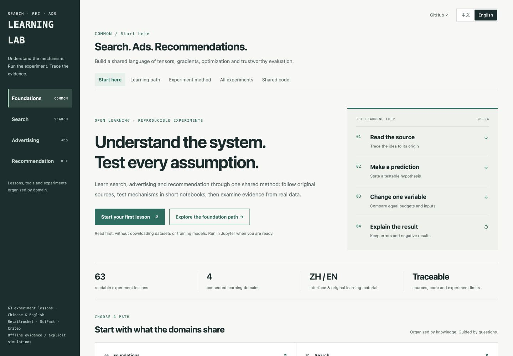

# Search · Ads · Recommendation Lab

**Learn how retrieval, ranking, and advertising decisions work—from the first tensor to an inspectable experiment.**

**[Read online →](https://lynnlee1229.github.io/search-recommendation-ads-lab/)** · **[中文课程](https://lynnlee1229.github.io/search-recommendation-ads-lab/zh/)**

English · [简体中文](README.zh-CN.md) · [Setup guide](docs/GETTING_STARTED.md) · [Roadmap](docs/ROADMAP.md) · [Contribute](CONTRIBUTING.md)

A bilingual, notebook-first learning lab with **63 lessons across four paths**. Follow a curriculum, read the original sources, predict what will happen, change one variable, and explain the result. Open the public course reader in your browser; clone this repository for the accompanying experiments and complete Lab experience.

| Path | What you will learn | Start here |
|---|---|---|
| **Foundations** · 4 lessons | Tensors → gradients → optimization → evaluation | [31 · Tensors](https://lynnlee1229.github.io/search-recommendation-ads-lab/en/lessons/common_31/) / [中文](https://lynnlee1229.github.io/search-recommendation-ads-lab/zh/lessons/common_31/) |
| **Search** · 19 lessons | User needs → query processing → retrieval → ranking → suggestions | [35 · Relevance judgments](https://lynnlee1229.github.io/search-recommendation-ads-lab/en/lessons/search_35/) / [中文](https://lynnlee1229.github.io/search-recommendation-ads-lab/zh/lessons/search_35/) |
| **Advertising** · 23 lessons | Products and markets → eligibility → response prediction → auctions → feedback | [47 · Advertising products](https://lynnlee1229.github.io/search-recommendation-ads-lab/en/lessons/ads_47/) / [中文](https://lynnlee1229.github.io/search-recommendation-ads-lab/zh/lessons/ads_47/) |
| **Recommendation** · 17 lessons | Behavior → candidates → ranking → training → evaluation | [01 · Data and ItemCF](https://lynnlee1229.github.io/search-recommendation-ads-lab/en/lessons/data/) / [中文](https://lynnlee1229.github.io/search-recommendation-ads-lab/zh/lessons/data/) |



## Quick start

**Read online:** [open the course website](https://lynnlee1229.github.io/search-recommendation-ads-lab/)—no installation or account required. It opens in English; the language switch takes you to the matching Chinese page. Read explanations, code, recorded results and original source references. The website does not execute notebooks or expose local data. The source notebooks remain available on GitHub in [English](notebooks/en) and [Chinese](notebooks).

English and Chinese editions explain the same experiments. Experiment code and saved outputs remain unchanged; English notebooks add one directory-setup cell. Chinese examples and original output labels are retained where they are part of an experiment.

**Run the experiments and use the complete Lab:** clone the repository, install the project environment, and open the workbench.

```bash
git clone https://github.com/lynnlee1229/search-recommendation-ads-lab.git
cd search-recommendation-ads-lab
./setup.sh --minimal
./lab.sh up
```

Open [localhost:18580](http://127.0.0.1:18580). The minimal setup installs dependencies, including PyTorch and Jupyter, without downloading datasets or training models. Prepare each real-data domain using the [setup guide](docs/GETTING_STARTED.md).

**Optional local reader:** after cloning, `python3 scripts/preview.py` serves the reading experience with Python 3.9+ and no installed packages. It uses the same port; if the full Lab is already running, use it instead. Stop your preview with `Ctrl+C` before starting the full Lab.

The full workflow was tested on **Apple M1 Pro, 16 GB, macOS 15, Python 3.12**. The macOS setup requires Apple Silicon, macOS 14+, and `brew install libomp`. Other platforms have not received the same end-to-end validation. See [setup, prerequisites, and domain downloads](docs/GETTING_STARTED.md) before running data-dependent lessons. CPU experiments do not require a GPU or Docker.

## What makes this useful

- **One curriculum, four clear domains.** Shared foundations come first. Search starts with user needs; advertising starts with products and markets. Algorithms live inside their domain.
- **Sources beside practice.** Author lectures, papers, and textbooks inform the learning paths. Source references explain which chapter or topic supports the lesson, and where the Lab adds its own teaching exercise.
- **Short, inspectable experiments.** Trace tensor shapes, hand-check a ranking metric, inspect a query pipeline, compare model variants, or balance an auction ledger.
- **Real training with visible limits.** Retailrocket and XMRec recommendation, SciFact retrieval and small-budget TinyBERT fine-tuning, and Criteo CTR experiments have recorded protocols. Synthetic mechanisms and simulated markets are labeled separately.
- **Results you can question.** Splits, configurations, hashes, and limitations are recorded. A fine-tune that does not improve and an FM that overfits remain part of the lesson.

The Lab is for learners who know some Python and want to connect theory to system behavior. Begin with foundations if tensors or evaluation feel unfamiliar; otherwise choose a domain from the [ordered learning paths](docs/GETTING_STARTED.md#choose-a-learning-path).

## Course and research sources

This is an independent teaching project, with no affiliation or endorsement from the authors below. Original material keeps its original language and rights; the Lab's English lessons are not translations of the authors' complete courses.

| Domain | Primary references | Scope of the reference |
|---|---|---|
| Recommendation | [Shusen Wang · Recommender System](https://github.com/wangshusen/RecommenderSystem) | Chinese course; 45 lecture PDFs are mapped to Lab topics. Coverage varies from mechanisms to real-data experiments. |
| Search | [Shusen Wang · Search Engine](https://github.com/wangshusen/SearchEngine/tree/7339c6b126e314abdb74a89adb033d39d8e3d37b), [BERT](https://arxiv.org/abs/1810.04805v2), [BERT passage reranking](https://arxiv.org/abs/1901.04085v5) | The pinned course has six outline modules and nine linked PDFs. Later modules are outline-level references; Lab lessons supply additional practice. |
| Advertising | [《计算广告》第2版 publisher table of contents](https://read.douban.com/ebook/371259701/), [Chinese computational-advertising chapter on GitHub](https://github.com/SocratesClub/ccrbook/tree/6dbd5650f2adc6e257e5bd5d156bc50a72560ee9/slides), [Zhang & Xu · CIKM 2016 RTB tutorial](https://wnzhang.net/slides/cikm-16-rtb-full.pdf) | A product-led syllabus, one Chinese book-companion slide chapter, and an English technical tutorial. None is presented as a complete modern production course. |

Pinned revisions, source roles, data/model provenance, and reuse boundaries are recorded in [third-party attribution](docs/THIRD_PARTY.md) and the [source audit](docs/COURSE_AUDIT_SOURCES.json).

## Read the evidence correctly

| Label | What it demonstrates | What it does not establish |
|---|---|---|
| **Real-data experiment** | A stated method on a fixed public sample and split | Production quality, a new blind benchmark, or online lift |
| **Constructed mechanism** | An equation, invariant, or failure case on controlled examples | Accuracy on real user behavior |
| **Simulated market** | Payments, allocation, or budget behavior under explicit assumptions | Actual revenue, causal advertiser value, or a production RTB system |

The current search and advertising paths cover **18 core teaching units each**. “Covered” describes those teaching goals. Trained query understanding, production ANN, real conversion/attribution data, and concurrent billing are still deeper work; see the [concrete gaps and acceptance criteria](docs/ROADMAP.md).

## Reproduce and contribute

The full setup prepares the original recommendation/XMRec experiments; search and advertising are opt-in:

```bash
./setup.sh                                       # original recommendation + XMRec setup
.venv/bin/python -m reclab.search --download       # SciFact and frozen models
.venv/bin/python -m reclab.ads --download          # Criteo sample and CTR models
```

These commands download inputs and run experiments. Read [Getting started](docs/GETTING_STARTED.md) for storage, platform, and rerun details. Datasets, model weights, credentials, and per-example predictions stay outside Git; compact results and teaching outputs are versioned.

Useful contributions include a clearer explanation, a numerical counterexample, a translation correction, a reproducible platform fix, or a well-scoped new experiment. Start with the [contribution guide](CONTRIBUTING.md) and [roadmap](docs/ROADMAP.md). If the Lab helps you learn, a star makes it easier to find again; an issue describing where you got stuck helps improve the next lesson.

[English interface screenshot](docs/screenshots/english.png) · [Technical protocols](docs/GETTING_STARTED.md#experiment-protocols) · [License scope](LICENSE.md) · [Third-party materials and rights](docs/THIRD_PARTY.md) · [Publishing and discovery](docs/PAGES_DISCOVERY.md)
