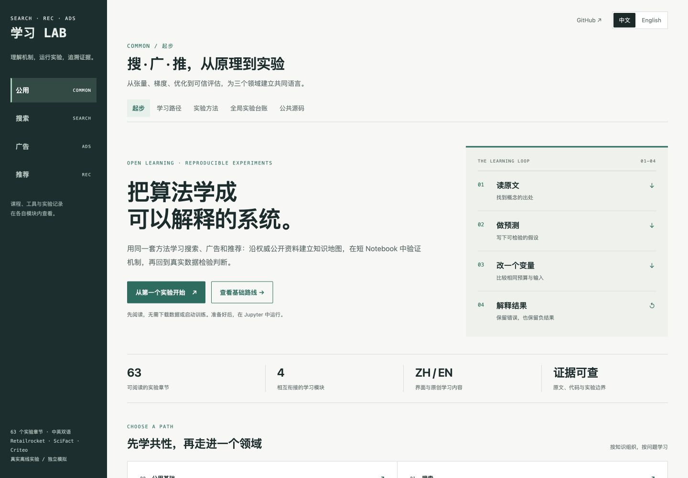

# 搜索 · 广告 · 推荐学习 Lab

**从第一个张量到可检查的真实实验，理解检索、排序和广告决策。**

[English](README.md) · 简体中文 · [开始学习](docs/GETTING_STARTED.zh-CN.md) · [后续路线](docs/ROADMAP.zh-CN.md) · [参与贡献](CONTRIBUTING.md)

一个中英双语、以 Notebook 为主线的学习 Lab：**63 节课，四条路径**。沿课程体系学习，回查原始讲义，先预测结果，再改一个变量，运行后解释差异。可以先读课，再决定是否安装训练环境。

| 路径 | 学习主线 | 从这里开始 |
|---|---|---|
| **公用基础** · 4 节 | 张量 → 梯度 → 优化 → 评估 | [31 · 张量与线性代数](notebooks/31_Common_Tensors.ipynb) / [English](notebooks/en/31_Common_Tensors.ipynb) |
| **搜索** · 19 节 | 用户需求 → 查询处理 → 召回 → 排序 → 查询推荐 | [35 · 需求与相关性判断](notebooks/35_Search_Needs_Judgments.ipynb) / [English](notebooks/en/35_Search_Needs_Judgments.ipynb) |
| **广告** · 23 节 | 产品与市场 → 资格候选 → 响应预测 → 拍卖 → 投放反馈 | [47 · 广告产品与参与方](notebooks/47_Ads_Products.ipynb) / [English](notebooks/en/47_Ads_Products.ipynb) |
| **推荐** · 17 节 | 用户行为 → 候选 → 排序 → 训练 → 评估 | [01 · 数据与 ItemCF](notebooks/01_Data_Features_ItemCF.ipynb) / [English](notebooks/en/01_Data_Features_ItemCF.ipynb) |



## 先读课，再运行

**无需安装：** 直接在 GitHub 打开上面的 Notebook。中英两版解释同一套实验；实验代码与历史输出保持一致，英文版仅增加一个工作目录初始化单元；中文分词样例和原始输出标签按实验需要保留。

**本地阅读：** 克隆后用 Python 3.9+ 标准库启动预览，无需安装依赖、下载数据或训练模型。

```bash
git clone https://github.com/lynnlee1229/search-recommendation-ads-lab.git
cd search-recommendation-ads-lab
python3 scripts/preview.py
```

打开 [localhost:18580](http://127.0.0.1:18580)，选择 **中文 / English**，进入一条路径，阅读讲解、代码和已保存的输出。阅读模式不执行代码。若该端口已有 Lab 在运行，直接使用现有服务。

**运行 Notebook：** 安装项目环境，再打开工作台。这一步安装 PyTorch、Jupyter 等依赖，不下载数据集、不训练模型。

```bash
./setup.sh --minimal
./lab.sh up
```

完整流程已在 **Apple M1 Pro、16 GB、macOS 15、Python 3.12** 验证。macOS 安装要求 Apple Silicon、macOS 14+，并需要 `brew install libomp`。其他平台尚未完成相同范围的端到端验收。运行依赖真实数据的课程前，请查看[安装、先修与分领域数据准备](docs/GETTING_STARTED.zh-CN.md)。CPU 实验无需 GPU 或 Docker。

## 这里能帮你学到什么

- **按知识体系走。** 共享基础放在前面；搜索从用户需求开始，广告从产品和市场开始。算法和工具始终放在所属领域内。
- **把原始资料和练习连起来。** 作者课程、论文和教材决定主线；逐课说明对应主题，以及 Lab 自编练习的范围。
- **用短实验理解细节。** 检查张量形状，手算排名指标，追踪查询链路，对照模型，核对拍卖账本。
- **真实训练有明确边界。** Retailrocket / XMRec 推荐、SciFact 检索与小预算 TinyBERT 微调、Criteo CTR 都有实验协议。构造机制、真实数据和模拟市场分别标记。
- **可以质疑结果。** 切分、配置、哈希和限制可回查；微调没有提升、FM 过拟合等负结果会留下来解释。

适合会一些 Python、希望把理论和系统行为连起来的学习者。如果张量、梯度或评估还不熟，先学公用基础；否则按[有序学习路径](docs/GETTING_STARTED.zh-CN.md#选择学习路径)进入一个领域。

## 课程和研究来源

这是独立教学项目，与下列作者没有隶属或背书关系。原始资料保持原语言与权利归属；Lab 的英文教材不是对作者完整课程的翻译。

| 领域 | 主要资料 | 使用范围 |
|---|---|---|
| 推荐 | [王树森《工业界的推荐系统》](https://github.com/wangshusen/RecommenderSystem) | 映射 45 份中文讲义主题；配套内容从机制练习到真实数据实验，深度各有标记。 |
| 搜索 | [王树森《搜索引擎技术》](https://github.com/wangshusen/SearchEngine/tree/7339c6b126e314abdb74a89adb033d39d8e3d37b)、[BERT 原论文](https://arxiv.org/abs/1810.04805v2)、[BERT 重排论文](https://arxiv.org/abs/1901.04085v5) | 固定版本包含六大模块目录和 9 份已链接 PDF；后续模块以目录为参考，由 Lab 补充教学练习。 |
| 广告 | [《计算广告》第 2 版出版社目录](https://read.douban.com/ebook/371259701/)、[GitHub 中文“计算广告”章节课件](https://github.com/SocratesClub/ccrbook/tree/6dbd5650f2adc6e257e5bd5d156bc50a72560ee9/slides)、[Weinan Zhang 与 Jian Xu 的 CIKM 2016 RTB 教程](https://wnzhang.net/slides/cikm-16-rtb-full.pdf) | 分别用于产品主线、一本教材的中文单章 PPT、英文技术教程；不把任何一份称作完整现代工业课程。 |

固定版本、资料类型、数据和模型来源、使用边界见[第三方归属说明](docs/THIRD_PARTY.md)及[来源审计](docs/COURSE_AUDIT_SOURCES.json)。

## 如何理解实验结果

| 标记 | 可以说明什么 | 不能据此说明什么 |
|---|---|---|
| **真实数据实验** | 固定公开样本和切分上的方法行为 | 生产效果、新的盲测成绩或线上提升 |
| **构造机制** | 受控例子中的公式、不变量或失败情况 | 真实用户上的准确率 |
| **模拟市场** | 给定假设下的支付、分配和预算行为 | 真实收入、广告因果增益或生产 RTB 能力 |

搜索和广告各覆盖 **18 个核心教学单元**。“覆盖”指这些教学目标已配练习；训练式查询理解、生产 ANN、真实转化与归因数据、并发计费等仍有深入空间。[后续路线](docs/ROADMAP.zh-CN.md)列出具体缺口与验收要求。

## 复现和参与

完整安装准备原有推荐 / XMRec 实验；搜索和广告按需运行：

```bash
./setup.sh                                       # 原有推荐与 XMRec 完整流程
.venv/bin/python -m reclab.search --download       # SciFact 与冻结模型
.venv/bin/python -m reclab.ads --download          # Criteo 样本与 CTR 模型
```

这些命令会下载输入并运行实验。磁盘、平台和重跑方式见[开始学习](docs/GETTING_STARTED.zh-CN.md)。数据、权重、凭据和逐条预测不进入 Git；仓库保留精简结果与教学输出。

欢迎更清楚的解释、数值反例、翻译修正、可复现的平台修复，以及范围明确的新实验。先读[贡献指南](CONTRIBUTING.md)和[后续路线](docs/ROADMAP.zh-CN.md)。如果它对学习有帮助，可以点一个 Star 留作索引；告诉我们卡在哪一节，也能直接帮助改进课程。

[英文界面截图](docs/screenshots/english.png) · [实验协议](docs/GETTING_STARTED.zh-CN.md#实验协议) · [许可范围](LICENSE.md) · [第三方资料与权利](docs/THIRD_PARTY.md)
